<p align="center">
  <a href="https://mohammed-tabibi.netlify.app/">
    
  </a>
</p>

<p align="center">
  <a href="https://mohammed-tabibi.netlify.app/"></a>
  <a href="https://www.linkedin.com/in/mohammed-tabibi-b2a6632a0"></a>
  <a href="mailto:mohammedtabibi2002@gmail.com"></a>
  
</p>

<br/>

<p align="center">
  
</p>

<br/>

## `GET /api/experience` <sub><code>200 OK</code></sub>

```json
{
  "role": "Stagiaire Développeur Full Stack",
  "company": "Wilaya d'Oujda-Angad",
  "period": "Été 2026",
  "mission": "Digitalisation des déclarations de passeports",
  "architecture": {
    "gateway": "YARP",
    "messaging": "RabbitMQ",
    "style": "microservices"
  },
  "features": [
    "Gestion des fiches",
    "Recherche par CNIE",
    "Génération de PDF avec QR code"
  ],
  "stack": ["React", "TypeScript", "ASP.NET Core", "SQL Server", "Docker"]
}
```

<br/>

## `GET /api/projects` <sub><code>200 OK</code></sub>

<p align="center">
  
</p>

<details>
<summary><b>🔍 <code>docker inspect smart-notes-ai</code></b> — gestion des notes boostée à l'IA</summary>
<br/>

> App Full Stack avec **authentification JWT**. L'IA (Gemini) génère des **résumés**, extrait les **points clés** et crée des **quiz** automatiquement.


</details>

<details>
<summary><b>🔍 <code>docker inspect rihlaty-ride</code></b> — transport scolaire intelligent (SaaS)</summary>
<br/>

> Plateforme **SaaS en microservices** : **suivi GPS** des bus scolaires et **optimisation des itinéraires** avec Google OR-Tools.


</details>

<details>
<summary><b>🔍 <code>docker inspect wilaya-passeports</code></b> — projet de stage</summary>
<br/>

> Digitalisation des déclarations de passeports : fiches, recherche par **CNIE**, **PDF avec QR code**, architecture **microservices** (YARP + RabbitMQ).


</details>

<details>
<summary><b>🔍 <code>docker inspect transport-intl</code></b> — transport international de marchandises</summary>
<br/>

> Gestion des **demandes**, du **suivi des livraisons** et des **paiements**.


</details>

<details>
<summary><b>📂 <code>ls ./autres-depots</code></b></summary>
<br/>

| Dépôt | Description |
|:--|:--|
| 🛒 [projet_symfony_e-commerce](https://github.com/Mohammed-Tabibi/projet_symfony_e-commerce) | Boutique en ligne avec Symfony |
| 🧙 [hogwarts-academy](https://github.com/Mohammed-Tabibi/hogwarts-academy) | Projet TypeScript |
| 🌐 [portfolio](https://github.com/Mohammed-Tabibi/portfolio) | Mon portfolio → [en ligne](https://mohammed-tabibi.netlify.app/) |
| 🏠 [maskani](https://github.com/Pedroxsbai/maskani) | Contribution en équipe : fondations et authentification |
</details>

<br/>

## `GET /api/skills` <sub><code>200 OK</code></sub>

```yaml
# docker-compose.skills.yml
services:
  languages:  [java, csharp, php, typescript, python]
  backend:    [spring-boot, aspnet-core]
  frontend:   [angular, react]
  data:       [mysql, sql-server, postgresql]
  messaging:  [rabbitmq, yarp]
  devops:     [git, github, gitlab, maven, docker, kubernetes]
  design:     [mvc, solid, singleton, uml, merise]
```

<p align="center">
  
  <br/>
  
</p>

<br/>

## `GET /api/education` <sub><code>200 OK</code></sub>

```bash
$ git log --graph --oneline parcours
* 3f9a2c1 (HEAD -> main)  2024–2027  Cycle ingénieur · Génie Informatique — EHEIM, Oujda
* 8b4e7d0                 2022–2024  Cycle préparatoire — EHEIM, Oujda
* 1c6f3a9                 2021–2022  1re année universitaire — Faculté des Sciences, UMP Oujda
* 0a2d5e4 (tag: bac)      2020–2021  Bac Sciences Physiques, option Français — Lycée Oued Eddahab
```

<br/>

## `GET /api/metrics` <sub><code>200 OK</code></sub>

<p align="center">
  
</p>

<p align="center">
  <picture>
    <source media="(prefers-color-scheme: dark)" srcset="https://raw.githubusercontent.com/Mohammed-Tabibi/Mohammed-Tabibi/output/pacman-contribution-graph-dark.svg">
    <source media="(prefers-color-scheme: light)" srcset="https://raw.githubusercontent.com/Mohammed-Tabibi/Mohammed-Tabibi/output/pacman-contribution-graph.svg">
    
  </picture>
</p>

<br/>

## `GET /api/offline` <sub><code>200 OK</code></sub>

```json
{ "hobbies": ["✈️ voyages", "🎮 jeux vidéo", "⚽ football"], "speaks": ["arabe", "français", "anglais"] }
```

<br/>

<p align="center">
  
</p>
